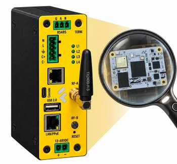

## Сотрудничество Napiworld и ELRON

Napiworld (ГК «Ниеншанц-Автоматика») и компания **ELRON** начали технологическое сотрудничество. Вместе мы планируем выпускать линейку промышленных мини-ПК в двух вариантах: сборщик данных без графики и с графической подсистемой.

<!--truncate-->

## Об ELRON

[ELRON](https://elron.tech) (ООО «Элрон», Новосибирск) - российский разработчик и производитель вычислительных платформ. Компания делает ставку на отечественную элементную базу: российские процессоры, микроконтроллеры и печатные платы.

Чем занимается ELRON:

- контрактная разработка приборов и программно-аппаратных комплексов, сбор, передача и обработка данных, разработка ПО;
- собственное производство: SMT- и THT-монтаж печатных плат, сборка и контроль устройств;
- **ELTAY** - одноплатные компьютеры и процессорные модули для встраиваемых систем и промышленности, на российских и зарубежных процессорах, в том числе в связке с микроконтроллерами и ПЛИС;
- **ELBEAR** и **ELSOMIK** - Arduino-совместимые платы и модули на российском микроконтроллере MIK32 «Амур».

## Модуль ELTAY RM66

Новые изделия будут построены на модулях семейства ELTAY. Первым на испытания пришёл **ELTAY RM66**: процессор Rockchip RK3566 (4 ядра Cortex-A55), форм-фактор CM4. Модуль совместим с Compute Module 4 по разъёмам, поэтому он ставится в наши платформы, разработанные под Orange Pi CM4.

Модуль тестируется на трёх наших платформах:

- промышленный компьютер «Сборщик-универсал» [FCUCM4](/docs/computers-industrial/FCUCM4/);
- система сбора данных [MFCUCM4](/docs/boards/napi-cm4/#система-сбора-данных-mfcucm4);
- одноплатный компьютер [FCU3566](/docs/boards/napi-cm4/#одноплатный-компьютер-fcu3566).

:::tip Новая модель
**Сборщик FCUCM4 с модулем RM66 выделен в отдельную модель - [FCURM66](/docs/computers-industrial/FCURM66/).**
:::

## Что проверяем

- работу системы сбора данных под [NapiLinux](http://napilinux.ru);
- координатор Zigbee-сети;
- шлюз Modbus;
- шлюз SNMP.

По результатам испытаний мы вместе с ELRON выберем конфигурации серийных изделий и назначим сроки их выхода. О них расскажем отдельно.

## Почему это важно

> «Китайские вендоры выпускают продукцию быстрее и дешевле - это приходится признавать. Но заказчику нужна не просто плата, а система, которая годами стабильно работает на объекте. Наше преимущество - собственное ПО и техническая поддержка: мы развиваем NapiLinux и отвечаем за результат. Сотрудничество с ELRON объединяет компетенции двух российских команд, и аппаратная и программная части решения согласованы с самого начала».
>
> **Дмитрий Новиков**, руководитель проекта Napiworld

Хотите протестировать сборщик на ELTAY RM66 на своём объекте? Пишите: [Контакты](/contacts).
