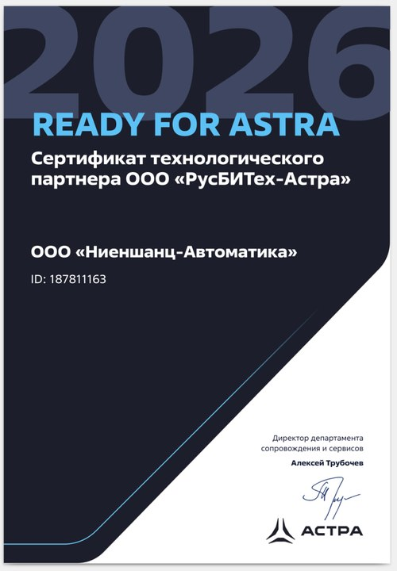

## NAPI2 и Astra Linux

Завершён полный цикл тестирования одноплатного компьютера **[NAPI2](/docs/computers/napi2/)** с операционной системой **Astra Linux**. По его результатам платформа одобрена для поставки с российской ОС.

<!--truncate-->

Теперь NAPI2 может поставляться с Astra Linux как готовое программно-аппаратное решение. Совместимость проверена не только на уровне запуска системы: платформа прошла полноценное тестирование.

## Сертификат READY FOR ASTRA

ООО «Ниеншанц-Автоматика», головная компания проекта Napiworld, получила сертификат технологического партнёра «Группы Астра» (ООО «РусБИТех-Астра») - **READY FOR ASTRA**.

## Что дальше

Совместимость с Astra Linux позволяет заказчикам получать промышленные решения NAPI с проверенным и поддерживаемым российским программным обеспечением. Ранее для платформ NAPI стала доступна [РОСА Хром 13](/blog/rosa-chrome-napi-support). Мы продолжаем расширять список операционных систем и программных решений для платформ NAPI.

По вопросам поставки NAPI2 с Astra Linux: [Контакты](/contacts).
