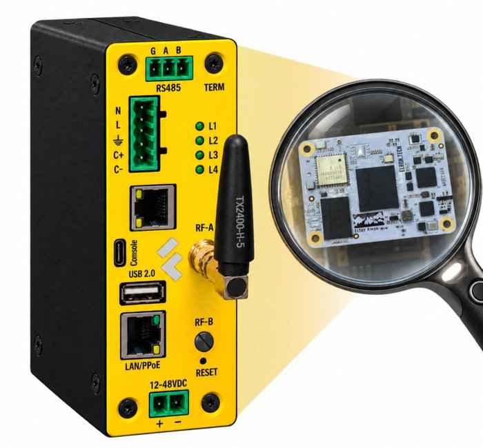

# Сборщик-универсал FCURM66

Сборщик Универсал на основе российского процессорного модуля [ELTAY RM66](https://elron.tech) производства ELRON (Rockchip RK3566, совместим с CM4) с встроенным датчиком тока, двумя Ethernet и модулем связи.

:::tip ELTAY RM66

ELTAY RM66 - российский процессорный модуль (SOM) производства ELRON на основе ARM процессора Rockchip RK3566 (четырёхъядерный 64-битный процессор Cortex-A55 до 1,8 ГГц), совместимый по форм-фактору и разъёмам с Compute Module 4 (CM4).
:::

## Отличие от FCUCM4

FCURM66 - это вариант [FCUCM4](/docs/computers-industrial/FCUCM4/) с российским процессорным модулем ELTAY RM66 вместо Orange Pi CM4.

> **По внешним интерфейсам и программному обеспечению FCURM66 полностью идентичен [FCUCM4](/docs/computers-industrial/FCUCM4/).**
> Состав, характеристики, габариты, работа с датчиком тока, модулями связи и консолью описаны на странице [FCUCM4](/docs/computers-industrial/FCUCM4/).
