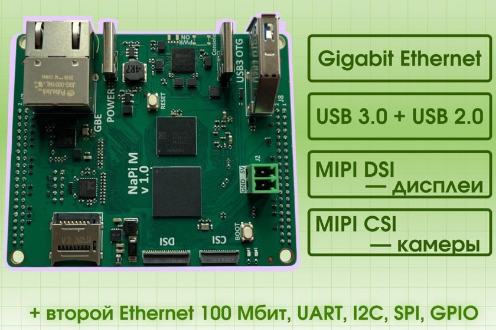
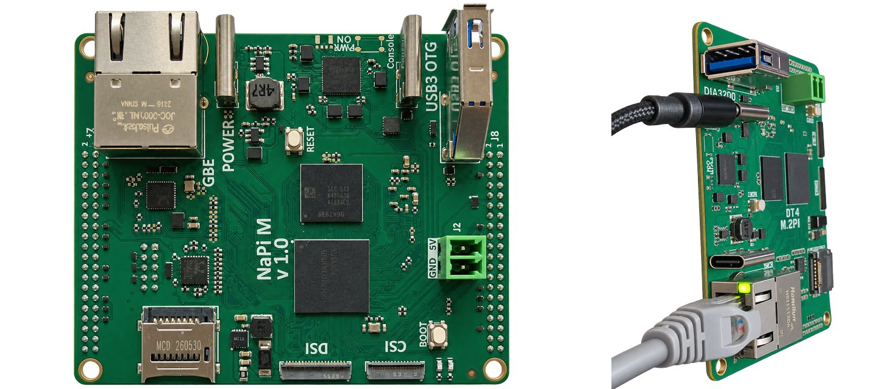
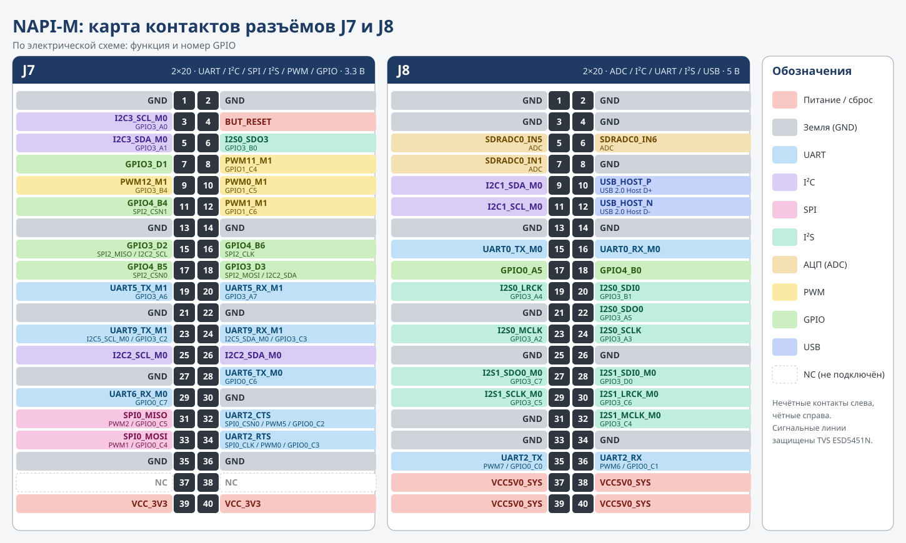
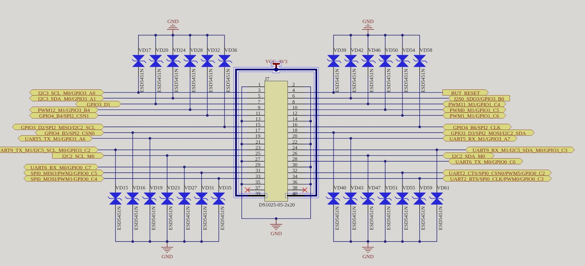
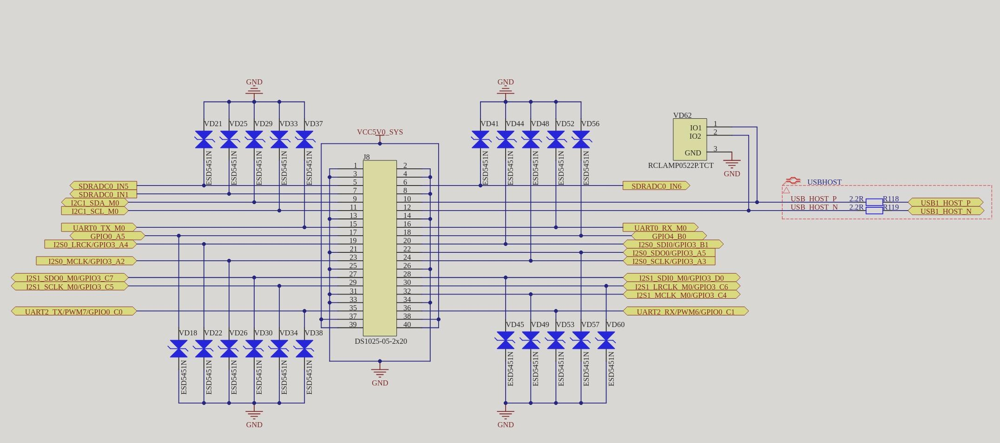

# NAPI-M

> **NAPI-M** - компактный одноплатный компьютер на Rockchip RK3562 для встраиваемых устройств: панельных устройств, HMI, терминалов и систем сбора данных. По возможностям и стоимости занимает место между [NAPI-C](/docs/computers/napi-c/) / [NAPI-P](/docs/computers/napi-p/) и [NAPI2](/docs/computers/napi2/).

:::info Статус
Первые образцы проходят тестирование. Цены будут объявлены в ближайшее время.

Принимаем заявки на тестирование NAPI-M: [napi@nnz.ru](mailto:napi@nnz.ru) или **[анкета на тестирование](/forms/napiorder/)**.
:::

---

## Интерфейсы на плате

- **Gigabit Ethernet** (RJ45)
- **USB 3.0 OTG** (Type-A) + USB 2.0 Host на разъёме расширения
- **Консоль** USB Type-C
- **MIPI DSI** для мобильных и встраиваемых дисплеев
- **MIPI CSI** для подключения камер
- **microSD**
- Кнопки **Power**, **Reset**, **Boot/Recovery**

На разъёмы расширения выведены: второй Ethernet 100 Мбит, USB, UART, I2C, SPI, I2S, PWM, ADC и GPIO.

---

## Внешний вид

### 3D-модель

3D-модель платы в формате STEP для проектирования корпусов и устройств: [скачать NaPi-M_v1.0.step (ZIP, 2.5 МБ)](step/NaPi-M_v1.0.zip)

---

## Технические характеристики

| Параметр | Значение |
|---|---|
| Процессор | Rockchip RK3562 |
| ОЗУ | 4 Гб LPDDR3 |
| Постоянная память | eMMC 5.1 16 или 32 Гб, слот microSD |
| Сеть | 1× Gigabit Ethernet RJ45 (RTL8211F); 1× 10/100 Мбит на разъёме расширения (RTL8201F) |
| USB | USB 3.0 OTG, USB 2.0 Host на разъёме расширения, консоль USB Type-C |
| Дисплей | MIPI DSI 4 линии, FPC 39 pin, I2C для сенсорной панели, подсветка |
| Камера | MIPI CSI до 4 линий, FPC 31 pin |
| Расширение | 2 разъёма 2×20 pin (J7, J8): UART, I2C, SPI, I2S, PWM, ADC, GPIO |
| Сервис | кнопки Power, Reset, Boot/Recovery |
| Питание | 5 В через USB Type-C или клеммник J2 |
| Размер | 70 × 81 мм |

:::tip Почему LPDDR3
LPDDR3 выбрана, чтобы сохранить доступную стоимость: NAPI-M дешевле NAPI2.
:::

---

## Разъёмы расширения J7 и J8

Назначение контактов по электрической схеме. Все сигнальные линии защищены TVS-диодами ESD5451N.

### Карта контактов

### J7 (2×20)

UART, I2C, SPI, I2S, PWM, GPIO. Питание 3.3 В.

### J8 (2×20)

ADC, I2C, UART, I2S, USB 2.0 Host, GPIO. Питание 5 В.

