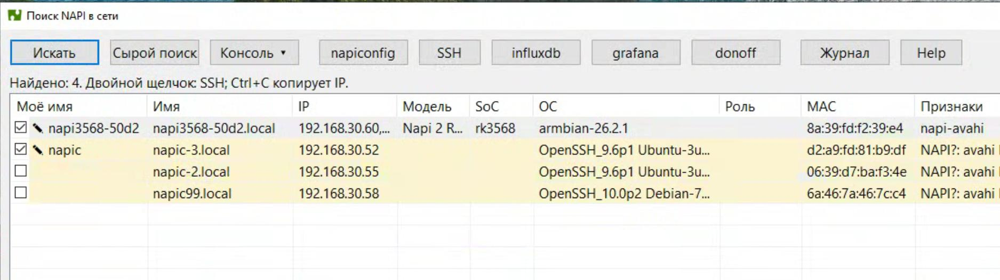
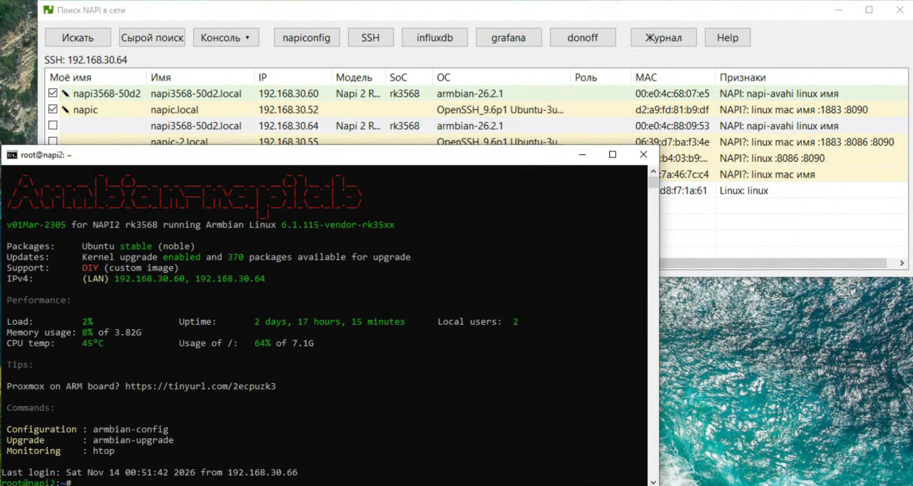
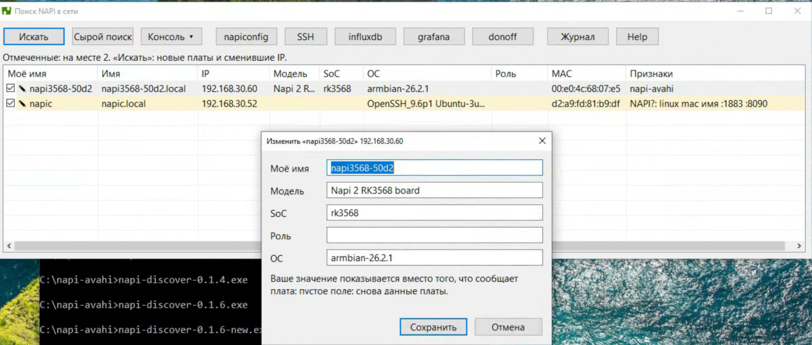
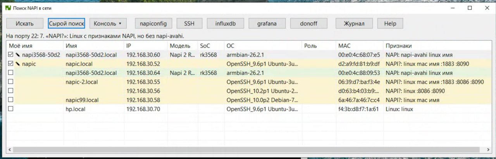

# Napi Discovery: как найти NAPI в сети

Одна из типичных проблем при первом запуске NAPI: как понять, на каком она IP-адресе? Чтобы упростить работу с платами, мы сделали небольшую утилиту **napi-discover**. Она ищет NAPI в сети и показывает её IP.



## Скачать

| Система | Файл |
|---|---|
| Windows 10/11 | [napi-discover.exe](https://github.com/lab240/napi-avahi/releases/latest/download/napi-discover.exe) |
| Linux (ПК, x86_64) | [napi-discover-linux-amd64](https://github.com/lab240/napi-avahi/releases/latest/download/napi-discover-linux-amd64) |
| Linux (ARM, arm64) | [napi-discover-linux-arm64](https://github.com/lab240/napi-avahi/releases/latest/download/napi-discover-linux-arm64) |

Все файлы и описание: [последний релиз на GitHub](https://github.com/lab240/napi-avahi/releases/latest). Исходный код: [github.com/lab240/napi-avahi](https://github.com/lab240/napi-avahi).

В Linux после скачивания сделайте файл исполняемым и запустите его:

```bash
chmod +x napi-discover-linux-amd64
./napi-discover-linux-amd64
```

---

## Возможности

### SSH и консоль прямо из программы

Можно зайти в NAPI по SSH или через консоль UART по USB-переходнику. Это особенно удобно в Windows: не нужно искать отдельный терминал и номер COM-порта.



### Постоянный доступ, если плат много

Отметьте плату галочкой и задайте ей своё имя, модель, роль и описание. Отмеченные платы видны сразу при запуске программы. Плата узнаётся, даже если сменила IP, и находится даже в другой подсети за роутером.



### Кнопки популярных сервисов NAPI

Кнопки **napiconfig**, **influxdb**, **grafana** и **donoff** в верхней панели открывают выбранную плату в браузере.

### Поиск плат с NapiLinux и Armbian

Если обычный поиск не сработал, нажмите **«Сырой поиск»**. Он перебирает все устройства в сети, похожие на NAPI, и предлагает кандидатов.



---

Если найти плату не получилось, смотрите статью [Как найти выданный IP](/software/notes/findip/).
